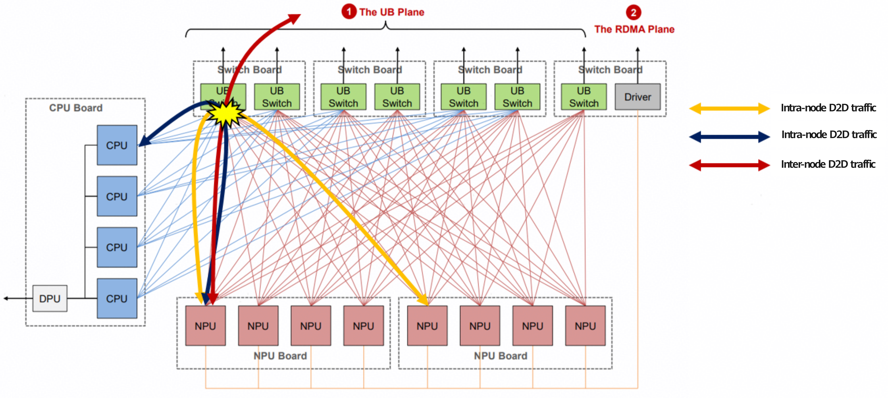
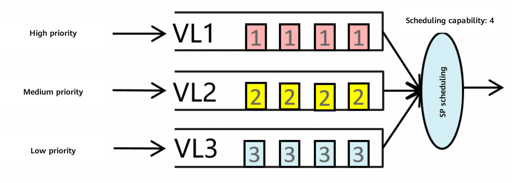
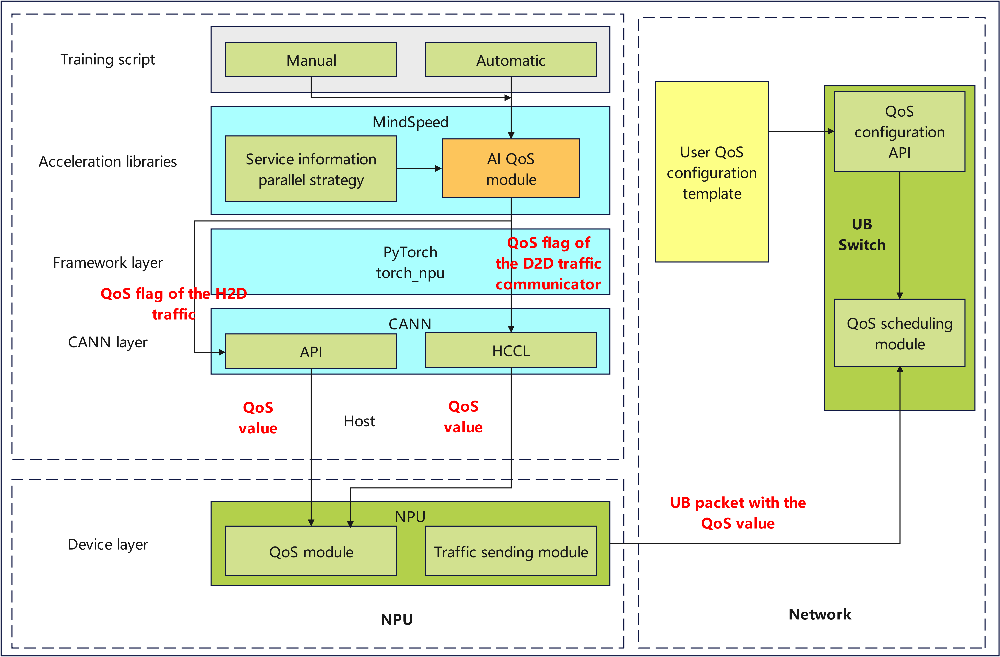

# AI QoS Differentiated Scheduling Feature Description

## Technical Background

For AI large model training, hybrid parallel methods are commonly used for distributed training. Taking the MoE large model as an example, a hybrid parallel strategy combining Tensor Parallelism (TP), Expert Parallelism (EP), Data Parallelism (DP), and Pipeline Parallelism (PP) is adopted. Traffic from the parallel strategy undergoes NPU-to-NPU (D2D) communication within the SuperPoD through the UB network.
Under different model sharding and model configurations, various types of traffic conflicts exist within the SuperPoD, including conflicts between D2D (such as TP and EP) traffic, as well as between H2D traffic (such as Swap) and D2D traffic. As shown in Figure 1, incast network conflicts occur at the UB Switch, causing network congestion and affecting overall communication performance.

<div align="center">

Figure 1 Traffic conflicts of different traffic types

</div>

Since different types of traffic contribute differently to computing efficiency, some communication traffic can achieve effective computation-communication overlap through upper-layer mechanisms, such as H2D Swap traffic or D2D DP traffic, while other traffic is difficult to overlap or can only be partially overlapped. Therefore, differentiated QoS scheduling can be applied to different traffic types to achieve a QoS mapping that optimizes computing efficiency.
When different types of traffic conflict, virtual channels (VLs) can be used at the UB Switch to isolate traffic, and differentiated scheduling can be performed between VLs to achieve:

(1) VL isolation between different traffic types to prevent congestion spreading

(2) Differentiated scheduling between different traffic types



<div align="center">
Figure 2 A typical QoS scheduling method — SP scheduling
</div>

As shown in Figure 2, different types of traffic are mapped to different VLs to achieve traffic isolation, and priorities are set for different VLs. Strict priority (SP) scheduling is adopted. When different types of traffic arrive at the UB Switch simultaneously, the high-priority VL is scheduled and drained first, followed by the next-level queue, and so on, thereby achieving differentiated scheduling for different types of traffic.

## Solution Introduction

Based on the above background, this feature provides an AI QoS differentiated scheduling solution that achieves the following:
(1) Different types of traffic are mapped to different VLs;
(2) Differentiated scheduling is performed between VLs, thereby improving the overall compute efficiency.
The feature can be enabled in the following two ways:
(1) Automatic mode: AI QoS perceives the traffic types, communication domains, communication volumes, and compute efficiency contributions of AI large model training, and designs a compute-efficiency-first priority mapping and scheduling algorithm. It implements VL mapping that minimizes conflicts between different traffic types and compute-efficiency-first differentiated QoS scheduling.
(2) Manual mode: You can manually specify the QoS priorities for different parallel strategies. AI QoS follows the user-specified priorities and, through multi-layer transmission and QoS semantic mapping, converts task-level QoS semantics into UB protocol QoS semantics, sets the QoS value in the UB packet, maps it to the corresponding VL on the UB Switch, and performs differentiated scheduling between VLs. The manual mode supports three QoS priority levels: Low, Middle, and High.
Note: Due to underlying capabilities, H2D traffic only supports channel-level overall QoS priority and does not yet support operator-level QoS priority. That is, it only supports QoS priority differentiation between H2D traffic and other traffic such as D2D, and does not support QoS priority differentiation between different operators within H2D traffic.
The overall solution architecture is shown in Figure 3:


<div align="center">
Figure 3 AI QoS differentiated scheduling solution architecture
</div>

D2D traffic uses the parallel strategy as the granularity. When a Group is created, the QoS marking is delivered to TorchNPU, transmitted to the NPU through CANN, and finally encapsulated into UB packets in the packet format. H2D traffic only supports global QoS priority setting at the channel level (excluding H2D traffic delivered by operators), and operator-level QoS priority setting for H2D traffic is not yet supported.
The UB Switch on the LingQu network has preconfigured QoS templates, including the mapping from QoS values to VLs and the scheduling policies between VLs. It also supports open QoS configuration templates, through which users can manually specify the mapping from QoS values to VLs and the scheduling policies between VLs.

## Usage

### Automatic Method

Add the following to the training script:
--aiqos  # AI QoS feature switch
--aiqos-mode auto  # Configure the AI QoS mode as automatic
The automatic mode currently supports the typical parallel strategies TP, PP, DP, EP, and CP.

### Manual Method

Add the following to the training script:
--aiqos  # AI QoS feature switch
--aiqos-mode manual  # Configure the AI QoS mode as manual
--aiqos-schedule {tp:high,pp:middle,dp:low}# Configure the QoS priorities for different parallel strategies
As shown in the example above, the TP priority is set to high, the PP priority to middle, and the DP priority to low.
The manual mode currently supports the dp, dp-cp, intra-dp-cp, inter-dp-cp, cp, mp, tp, pp, embd, pos-embd, tp-dp-cp, tp-dp, tp-cp, ep, ep-tp, tp-ep-mp, tp-ep-pp, ep-dp, and hcp parallel strategies.

## DCMI Usage Instructions

### Principles

Purpose: The A3 generation NPU uses a QoS fusion strategy to implement the QoS function of NPUs in the bus domain. This strategy fuses the control-plane QoS value (the mpam QoS delivered through the DCMI) with the fine-grained piggyback QoS value delivered along with the traffic (the piggyback QoS delivered through the training script) to obtain the final QoS value. The AI QoS feature calls the DCMI to ensure that the QoS value finally accepted by the NPU is the piggyback QoS value specified by the automatic or manual mode of the AI QoS feature. In addition, this interface is also used to deliver the QoS values of H2D/D2H traffic.
Principle: The specified fusion strategy takes the maximum of the control-plane QoS value and the piggyback QoS value, and sets the mpam QoS watermark so that the mpam QoS is lower than the piggyback QoS, so that the QoS value finally generated by the fusion strategy is the piggyback QoS.
Parameter description (fusion_qos): In fusion_qos, bw_low is the lower watermark limit, bw_high is the upper watermark limit, target is the mpamid value and can only be 0, and hardlimit being 0 means that no hardware limit is imposed on the bandwidth.
Parameter description (set_h2d_qos): set_h2d_qos is used to adjust the QoS value of H2D traffic. The qos parameter is used together with the LingQu switching network and supports low and middle priorities, corresponding to QoS values 2 and 4 of the LingQu network. mpamid ranges from 0 to 31, and the default value of bitmap is [0x1, 0, 0, 0], indicating the traffic channel in which the H2D traffic resides.

### SO Compilation Method

Go to the mindspeed/ops/csrc/qos directory, manually compile pybind11, change pybind11_install_dir in CMakeLists.txt in that directory to the pybind11 installation directory, and run the following commands. The SO is generated in the output directory:

 ```shell
mkdir build
cd build
cmake ..
make -j
 ```

### SO Usage Example

```python
import aiQos


CARD_ID_LIST = [0, 1, 2, 3, 4, 5, 6, 7]
DEVICE_ID_LIST = [0, 1]

def fusion_qos(bw_low=10, bw_high=50, target=0, hardlimit=0):
    """
    Set MPAM QoS bandwidth limit
    Parameters:
        bw_low (int): Minimum bandwidth, default value 10
        bw_high (int): Maximum bandwidth, default value 50
        target (int): Target bandwidth, default value 0
        hardlimit (int): Hard bandwidth limit, default value 0
    """
    aiQos.init()
    for card_id in CARD_ID_LIST:
        for device_id in DEVICE_ID_LIST:
            aiQos.set_gbl_qos(card_id=card_id, device_id=device_id, mode=1)
            aiQos.set_bw(
                target=target,
                bw_low=bw_low,
                bw_high=bw_high,
                hardlimit=hardlimit,
                card_id=card_id,
                device_id=device_id
            )

def set_h2d_qos(qos, mpamid, bitmap=[0x1, 0, 0, 0]):
    """
    Set QoS (Quality of Service) parameters for H2D (Host to Device) direction

    Parameters:
        qos (str): QoS level (required, string only)
                   - Only supports "low" (mapped to 2) and "middle" (mapped to 4)
                   - No integer values are allowed
        mpamid (int): MPAM (Memory Partitioning and Monitoring) ID (required, no default value)
                      Range: 0-31 (MPAM ID is a hardware resource identifier; values outside this range throw ValueError)
        bitmap (list): Bitmap parameter for QoS configuration, default value [0x1, 0, 0, 0]
                       Format: List of 4 integers, each element represents QoS control bits for different dimensions

    Raises:
        ValueError: 1. mpamid out of 0-31 range; 2. QoS string not "low"/"middle"
        TypeError: 1. mpamid not integer; 2. QoS not string type
        RuntimeError: Failed to initialize QoS module or apply QoS configuration
    """
    if not isinstance(mpamid, int):
        raise TypeError(f"mpamid must be an integer (0-31). Got type: {type(mpamid).__name__}")
    if mpamid < 0 or mpamid > 31:
        raise ValueError(f"mpamid must be between 0 and 31. Got: {mpamid}")
    if not isinstance(qos, str):
        raise TypeError(f"QoS must be a string ('low'/'middle'). Got type: {type(qos).__name__}")
    
    qos_lower = qos.lower()
    if qos_lower == "low":
        qos_numeric = 2
        print(f"Info: Mapped QoS string '{qos}' to numeric value {qos_numeric}")
    elif qos_lower == "middle":
        qos_numeric = 4
        print(f"Info: Mapped QoS string '{qos}' to numeric value {qos_numeric}")
    else:
        raise ValueError(f"QoS string only supports 'low' or 'middle'. Got: '{qos}'")

    try:
        aiQos.init()
        for card_id in CARD_ID_LIST:
            for device_id in DEVICE_ID_LIST:
                aiQos.set_gbl_qos(card_id=card_id, device_id=device_id, mode=1)
                aiQos.set_h2d_qos(
                    card_id=card_id,
                    device_id=device_id,
                    mpamid=mpamid,
                    qos=qos_numeric,
                    bitmap=bitmap
                )
    except Exception as e:
        raise RuntimeError(f"Failed to configure H2D QoS: {str(e)}") from e

fusion_qos()
set_h2d_qos('low', 20)
```

## Usage Scenarios and Version Compatibility

The AI QoS feature supports Atlas 800T A3 and Atlas 900 A3 SuperPoD, and requires the following software versions:

| Software        | Compatible Version                          |
| :---------- | :-------------------------------- |
| TorchNPU   | 7.3.RC1*                          |
| CANN        | CANN 8.6*                         |
| UB Switch   | LingQu Computing Network 1.6.0*   |

*Expected compatible versions. The specific versions will be updated after the relevant components are officially released.
