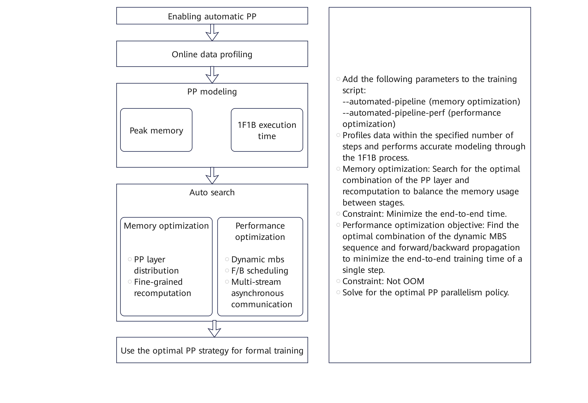

# PP Automatic Parallelism Algorithm

## Background and Challenges

Pipeline parallelism partitions the model network layers into multiple stages and maps the stages to different devices, so that different devices compute different parts of the neural network in parallel. Pipeline parallelism greatly alleviates the memory bottleneck of a single card and improves hardware utilization through pipelined training across multiple cards. Pipeline parallelism has become one of the most commonly used parallelism approaches for large model training. However, current pipeline parallelism is not optimal in terms of memory consumption and performance, and has two major problems:

1) Memory imbalance: Under the commonly used scheduling mode (1F1B) of pipeline parallelism, the memory occupied by the pipeline stages close to the front layers of the model is far larger than that of the later stages, with a gap of 2 to 3 times. Overall, the trainable model scale is limited by the memory consumption of PP-Stage 0.

2) Pipeline bubble: The 1F1B scheduling strategy of pipeline parallelism alternately performs forward and backward computation of micro-batch data on each device. Due to imbalanced computational loads among pipeline devices or fluctuations in network communication, waiting occurs between devices (pipeline bubble), which affects training performance.

## Solution

This system is based on online profiling and PP modeling search. By enabling the memory optimization module and the performance optimization module, it maximizes the memory and performance of pipeline parallelism training, respectively. The memory optimization module aims to automatically find the optimal layer distribution of stages in pipeline parallelism and a fine-grained recomputation module, evenly distribute the memory on each card, optimize the PP-Stages with memory bottlenecks, and reduce peak memory. The performance optimization module uses automatic optimization of the mbs sequence and the forward-backward scheduling sequence as well as a multi-stream asynchronous communication mechanism to compress pipeline bubbles and improve training performance.

### Memory Optimization Module

Based on online profiling and PP modeling search, it automatically constructs an optimal memory layout scheme to balance the memory overhead among stages, reducing peak memory while minimizing end-to-end training time, with good usability and generalizability. Specifically, it automatically searches for the optimal memory layout scheme in the joint search space of layer distribution and fine-grained recomputation:
①  PP layer distribution partitioning: An uneven layer partitioning strategy is adopted to automatically search for the optimal layer partitioning method, balancing the memory consumed by each card, thereby optimizing the PP-Stages with memory bottlenecks and reducing peak memory.
②  Fine-grained recomputation: Pipeline bubble time is used for recomputation to ensure that performance does not deteriorate, and the fine-grained recomputation strategy is automatically optimized to further reduce peak memory.

### Performance Optimization Module

Under the condition that the peak training memory overhead does not exceed the maximum memory capacity of the device, the end-to-end training time is minimized by automatically searching for the optimal mbs sequence and forward-backward scheduling sequence in pipeline parallelism.
①  Dynamic mbs: Under a given gbs, the optimal mbs sequence is automatically searched. A small mbs is used to accelerate the startup and cooldown of the pipeline and compress the bubble time, and in the steady phase the most efficient mbs is automatically found for computation, shortening the computation time of the steady phase and improving the end-to-end training performance.
②  Forward and backward scheduling: By adjusting the order of forward and backward computation during pipeline parallelism and combining it with a multi-stream asynchronous communication mechanism, the steady-phase bubble of the pipeline is compressed and the training performance is improved.

The PP automatic parallelism system is shown in the following figure:

 

## Application Scenarios

This system is mainly used in training scenarios where pipeline parallelism is enabled. Using the PP automatic parallelism system can effectively solve the problems of insufficient memory or an excessively large proportion of pipeline bubbles.
**Usage Conditions:**

1. `--pipeline-model-parallel-size >= 2`;
2. The memory optimization module and the performance optimization module cannot be used at the same time.

## Usage

(1) When memory is insufficient, the PP automatic parallelism memory optimization module can be enabled. First, add the `--automated-pipeline` flag to the training script to enable the feature.
(2) When the pipeline bubble is too large and the training performance is not optimal, the PP automatic parallelism performance optimization module can be enabled. First, add the `--automated-pipeline-perf` flag to the training script to enable the feature.

## Effects

Benefits of the PP automatic parallelism memory optimization module: For models trained with pipeline parallelism (PP), such as Llama-2-7b, Llama-2-13b, and Llama-2-70b, using this algorithm reduces the average peak memory by 11.5%, with an average performance degradation of less than 1%. Benefits of the performance optimization module: For models trained with PP, such as Llama-2-7b, Llama-2-13b, and Llama-3-8b, using this algorithm improves the average performance by 7.6%.
