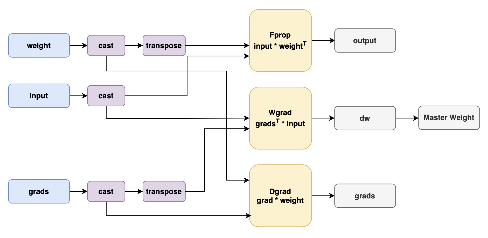

# Megatron Transformer-Engine

## Background and Challenges

Transformer Engine (TE) is a library specifically designed to accelerate the training and inference of models based on the Transformer architecture. Several current third-party frameworks rely on the APIs provided by this acceleration library for inference and training, and MindSpeed needs to provide equivalent support for these requirements.<!-- codespell:ignore -->
TE supports enabling 8-bit floating point (FP8) operations on the Ascend NPU hardware platform, delivering better performance with lower memory usage. TE provides typical modules for Transformer structures, as well as components such as a low-precision state manager, which can seamlessly replace large models built on Megatron-LM to achieve low-precision training.
The TE module provided by TransformerEngineNPU can replace the TE module provided by NVIDIA, making it easier to build Transformer layer modules. TE internally maintains the scaling factors and other low-precision training state values required for low-precision training, helping users migrate more easily from mixed-precision training to low-precision training.
In addition, the TE module provided by TransformerEngineNPU also includes an implementation of Communication Over Computation, which splits tasks that should originally be executed serially for communication and computation into finer-grained subtasks, thereby overlapping computation and communication to improve efficiency and increase model throughput.

## Solution

TransformerEngineNPU provides the TE APIs on Ascend NPU, and MindSpeed provides HiF8 / MXFP4 recipe enhancements. The main modules in `transformer_engine.pytorch` include:

- `LayerNorm`
- `LayerNormLinear`
- `GroupedLinear`
- `Linear`

In the low-precision training process, the GEMM operations in forward propagation (`Fprop`), activation backward propagation (`Dgrad`), and weight backward propagation (`Wgrad`) are quantized to FP8 precision for execution.
The overall network training process still follows the BF16/FP16 AMP mixed precision training flow, but specific computation operators perform calculations at FP8 precision, primarily the Matmul computations in the Linear layer, including Fprop, Dgrad, and Wgrad.
During the process of quantizing high-precision tensors to low precision, different scaling strategies exist:

- Delayed Scaling: Calculates the scaling factor based on historical amax values, then uses the scaling factor to quantize the tensor.
- Tensorwise Scaling: An online strategy that computes amax in real time and applies the scaling factor to quantize the tensor.
- Blockwise Scaling: Divides the tensor into blocks, then computes amax for each block and applies the scaling factor to quantize the tensor.
- MX Scaling: Converts floating-point vectors into MX blocks by combining block-level shared scales with low-bit-width elements, achieving dynamic quantization.

Supported low-precision data formats include:

- E4M3: 1 sign bit, 4 exponent bits, 3 mantissa bits, with a representable range of -448 to +448.
- E5M2: 1 sign bit, 5 exponent bits, 2 mantissa bits, with a representable range of -57344 to +57344.
- HiF8: 1 sign bit, dynamic dot bits, exponent bits, and mantissa bits, with a maximum representable value of 2E15.

## Application Scenario

**Backend limitation:** Using TE requires setting `--transformer-impl transformer_engine` (the default value).

When model training, inference, and third-party frameworks need to use related APIs, use the Megatron transformer_engine APIs.

| Capability | `local` | `transformer_engine` / TENPU |
| --- | --- | --- |
| CP>1 | Not supported | Supported, configured according to CP/mask/EOD type restrictions |
| Grouped GEMM | Not supported | Depends on TEGroupedMLP, subject to the combination restrictions of each feature |
| FP8/FP4 | Not supported | Provided by TENPU, configured according to recipe constraints |
| Standard DSA, GDN model construction | Does not support the complete local path | Components such as projection and normalization depend on TENPU |

## Usage

After installing the matching TransformerEngineNPU and MegatronAdaptor, enable TE by using `--transformer-impl transformer_engine` (the default value).
Set `--fp8-format e4m3` to select the low-precision data format. Currently, `e4m3`, `hybrid`, and `hif8` are supported. When `hybrid` is enabled, the E4M3 data format is used for forward training, and the E5M2 data format is used for backward propagation.
Set `--fp8-recipe delayed` to select the low-precision training scaling strategy. Currently, `tensorwise`, `delayed`, `hif8_delayed`, `mxfp8`, and `blockwise` are supported, with the default value being `delayed`.

**Note**

- `--use-ascend-mc2` replaces the native linear layers in the model and does not cover the TENPU TE Linear. For details, see [MC2](mc2.md). For the configuration of Grouped GEMM, see [MoE GMM](megatron_moe/megatron-moe-gmm.md).
- Low-precision GMM currently only uses the tensorwise, mxfp8, and delayed recipes; other recipes (including blockwise and hif8_delayed) fall back to BF16 GMM. If you do not need to enable it, you can use the parameter `--no-use-gmm-fp8`
- FP8 does not support `--transformer-impl local`.
- The HiF8 data format supports `--fp8-recipe tensorwise`, `delayed`, or `hif8_delayed`; `hif8_delayed` must be used together with `--fp8-format hif8`, enables step recovery by default, and is disabled with `--no-hif8-step-recovery`. For details, see [HiF8 DTS](hif8_dts.md).
- MXFP4 uses `--fp4-format e2m1 --fp4-recipe mxfp4`.
- `--fp8-reuse-quantized-weight` is only valid when FP8 is enabled.
- FP8 communication-computation fusion only supports the MXFP8 recipe combined with MC2.
- When using transformer_engine, `--use-flash-attn` must also be enabled

## Parameter Combination Restrictions

<table><thead>
  <tr>
    <th width='120'>TE Module Feature</th>
    <th>Combination</th>
    <th>Supported</th>
  </tr></thead>
<tbody>
  <tr>
    <td rowspan="5"> Low-precision training</td>
    <td rowspan="5">--transformer-impl transformer_engine
      --fp8-format e4m3/hybrid/hif8
      --fp8-recipe tensorwise/delayed/hif8_delayed/mxfp8/blockwise </td>
    <td style="text-align: center; vertical-align: middle">✅</td>
  </tr>
</tbody>
<tbody>
  <tr>
    <td rowspan="5"> Computation-communication overlap</td>
    <td rowspan="5">--transformer-impl transformer_engine
      --use-ascend-mc2 </td>
    <td style="text-align: center; vertical-align: middle">✅</td>
  </tr>
  </tbody>
  <tr>
    <td rowspan="5"> Low-precision computation-communication overlap</td>
    <td rowspan="5">--transformer-impl transformer_engine
      --fp8-format e4m3
      --fp8-recipe mxfp8
      --use-ascend-mc2 </td>
    <td style="text-align: center; vertical-align: middle">✅</td>
  </tr>
</table>
