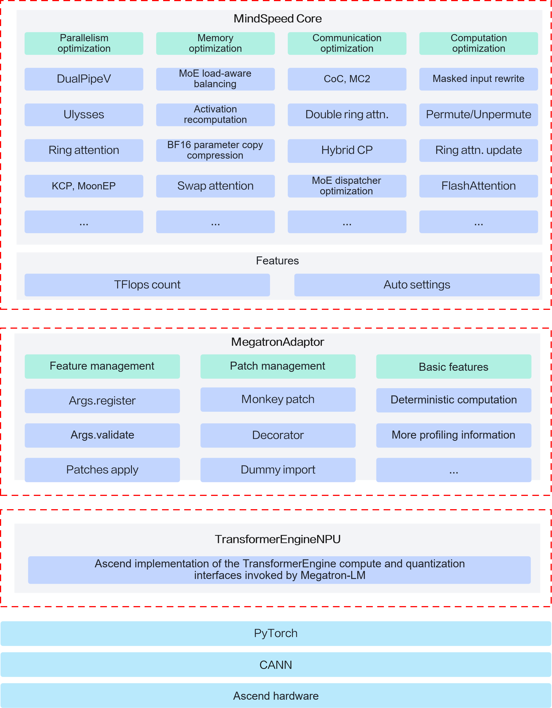

# Introduction

## Overview

MindSpeed Core is an acceleration library for large models on Huawei Ascend devices. Large model training is a highly complex process involving numerous technologies and challenges. A key difficulty is that large model training requires substantial device memory resources, posing a significant challenge for compute cards. To address the issue of insufficient device memory on a single compute card, the industry has developed third-party large model acceleration libraries such as Megatron and DeepSpeed. These libraries partition models and input data, distribute them across different compute cards, and then aggregate the results through collective communication. Ascend provides the MindSpeed Core acceleration library to enable rapid migration of customer large model services to Ascend devices, with support for Ascend-specific algorithms to ensure out-of-the-box usability.

## MindSpeed Core Architecture

The NPU-oriented PyTorch training path of MindSpeed Core consists of three basic adaptation and acceleration optimization components:

**MA and TENPU are mandatory components of this basic training solution, while MindSpeed Core is an optional acceleration component.** Megatron-LM performs basic NPU adaptation through MA and invokes the TE computing capability through TENPU. Using Megatron-LM + MA + TENPU alone is sufficient for basic training; when further acceleration is needed, install and enable MindSpeed Core. MindSpeed enhances the Megatron training process by reusing the feature/patch management interfaces of MA and the compute modules of TENPU.

- **MegatronAdaptor (MA)**: Responsible for the basic NPU adaptation of Megatron-LM, providing basic compatibility, feature management, and patch management interfaces for MindSpeed to extend.
- **TransformerEngineNPU (TENPU)**: Provides the NPU implementation of the Transformer Engine interface, including Linear, LayerNorm, DotProductAttention, and basic FP8 capabilities, supporting Megatron's TE computation path.
- **MindSpeed Core**: Builds on MA and TENPU to provide parallelism, memory, communication, and computation optimizations, as well as tool capabilities such as deterministic computation, performance analysis, and parallel strategy search. MindSpeed manages its own acceleration features and patches, reusing the extension mechanism provided by MA.

MindSpeed Core provides parallelism, memory, communication, and computation optimizations as well as tool, feature, and patch management capabilities. MA and TENPU are mandatory basic support: MA adapts Megatron-LM, and TENPU implements the TE interfaces it invokes. MindSpeed Core reuses the basic capabilities of MA and TENPU to provide acceleration optimizations for training as needed. The MindSpore path does not depend on the MA/TENPU adaptation process shown in this figure and should still be configured according to the corresponding documentation.

Figure 1 MindSpeed architecture

## Features

MindSpeed features consist of six major modules: parallelism strategies, memory optimization, affinity computing, communication optimization, key scenario support, and multimodality.
