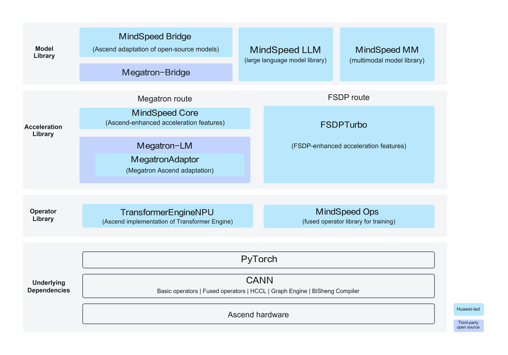

# MindSpeed Overview

MindSpeed is a large-model training software stack for Huawei Ascend NPUs, dedicated to helping mainstream open-source training ecosystems migrate to the Ascend platform at low cost while achieving Ascend-friendly training performance. MindSpeed covers capabilities such as model adaptation, distributed training, performance acceleration, operators, and low-precision computation, providing process support for pretraining, fine-tuning, inference evaluation, and weight conversion of large language models and multimodal models.

MindSpeed organizes its components into a model library, an acceleration library, and an operator library, with PyTorch, CANN, and Ascend hardware as underlying dependencies. The model library provides model adaptation and task workflows, the acceleration library provides training engine adaptation and Ascend-enhanced acceleration features, and the operator library provides low-precision computation and fused operator capabilities, jointly supporting upper-layer model training.

## Overall Architecture

**Figure 1** MindSpeed overall architecture

**Table 1** Introduction to MindSpeed components

| Component | Positioning | Main Capabilities |
| --- | --- | --- |
| MindSpeed LLM | Large language model library | Provides an end-to-end industrial-grade LLM training solution, covering distributed pretraining, instruction fine-tuning, post-training, online inference, and baseline evaluation, with 100+ mainstream large models and model architectures such as Dense, MoE, and SSM built in natively. |
| MindSpeed MM | Multimodal model library | Provides end-to-end training pipelines for multimodal understanding, text-to-image generation, and video generation, with 40+ groups of cutting-edge preset model examples built in. |
| MindSpeed Bridge | Open-source model adaptation for the Bridge route | Provides the provider/bridge/recipe toolkit for new models, supports lossless bidirectional weight conversion between Hugging Face and Megatron, and offers pluggable decoupling of core features. |
| TransformerEngineNPU | Ascend implementation of Transformer Engine | Supports low-precision formats such as E4M3 and HiF8 as well as scaling strategies such as MXFP8, provides high-performance Transformer computation modules, and reduces the cost of low-precision training migration and performance adaptation. |
| MegatronAdapter | Internal Ascend adaptation of Megatron-LM | Provides the basic compatibility capabilities required to run Megatron-LM/Megatron Core on Ascend NPUs, and adapts to device, runtime, and framework differences through feature management and patch mechanisms, reducing the adaptation cost of migrating the Megatron training stack to the Ascend platform. |
| FSDPTurbo | Enhanced acceleration for the FSDP solution | Provides memory reuse and mixed quantization management, and supports flexible and efficient combination with multi-dimensional parallel strategies such as TP, EP, and CP. |
| MindSpeed Core | Ascend enhanced acceleration for the Megatron route | Provides affinity optimization across the four dimensions of computation, memory, communication, and parallelism, focusing on Ascend-specific acceleration capabilities such as long sequences, MoE, communication-computation fusion, memory optimization, and low-precision training. |
| MindSpeed Ops | Training fusion operator library | Integrates full-scenario fusion operators and architecture-affinity kernels based on Triton-Ascend, TileLang, and AclNN, shields underlying hardware differences through a unified API, and enables efficient operator dispatch and performance release. |

## Key Features

- **Low-cost ecosystem migration**: Supports NPU-affinity adaptation of native Megatron-LM training scripts via "one-line import". Through standard commands of MindSpeed Bridge, it enables seamless integration of new Hugging Face models into the Megatron ecosystem, reducing duplicated development effort on model structures, configurations, and weight formats.

- **Dual distributed engine routes**: Supports two routes: deeply optimized Megatron and model-agnostic FSDP2. The Megatron route carries forward existing assets and provides multi-dimensional parallelism and performance tuning capabilities. The FSDP2 route adopts a design decoupled from model structures, providing configuration-based parallelism and memory optimization capabilities such as FSDP2, TP, EP, and CP for Hugging Face/PyTorch models, allowing flexible selection of the training backend based on model structure and training scenarios.

- **Model training pipeline support**: MindSpeed LLM covers large language model pretraining, full-parameter fine-tuning, post-training such as SFT/LoRA and DPO/GRPO/RLHF, as well as model evaluation, data processing, and weight conversion pipelines.

- **Broad model coverage**: Adapts to mainstream Dense, MoE, SSM, and multimodal architectures. MindSpeed LLM natively includes 100+ mainstream large language models. MindSpeed MM provides 40+ groups of model examples covering multimodal understanding, text-to-image, video generation, and speech.

- **Multi-dimensional parallel acceleration**: Supports strategies such as data parallelism, tensor parallelism, pipeline parallelism, context (long-sequence) parallelism, sequence parallelism, and expert parallelism, which can be flexibly combined according to model structure and cluster scale, and supports fully sharded FSDP2 large-scale training.

- **Ascend-affinity performance optimization**: Relies on memory reuse/swapping and dynamic activation recomputation to alleviate memory bottlenecks. Through compute-communication fusion, multi-level communication-computation overlap, MoE-specific communication optimization, long-sequence optimization, and high-performance custom operators, it improves training efficiency and compute resource utilization of large-scale clusters.

- **Low-precision training**: Provides low-precision capabilities covering formats and training strategies such as FP8, MXFP8, HiF8, and W8A16. Through components such as TransformerEngineNPU, MindSpeed Core, and FSDPTurbo, it implements optimizations including low-precision computation, block-wise quantization, and low-precision communication, reducing computation, communication, and memory overhead while maintaining training accuracy, thereby improving large model training efficiency.

- **Mainstream ecosystem compatibility**: Provides API, model, and weight format adaptation capabilities for mainstream training ecosystems such as Megatron Core, Hugging Face, PyTorch FSDP2, Transformer Engine, and Megatron-Bridge. While maintaining compatibility with upstream ecosystem evolution, it provides Ascend-affinity extensions, reducing the cost of framework migration, model adaptation, and version upgrades.

## More Information

For more information about MindSpeed, see the online course: [MindSpeed](https://www.hiascend.com/edu/courses?activeTab=MindSpeed).
