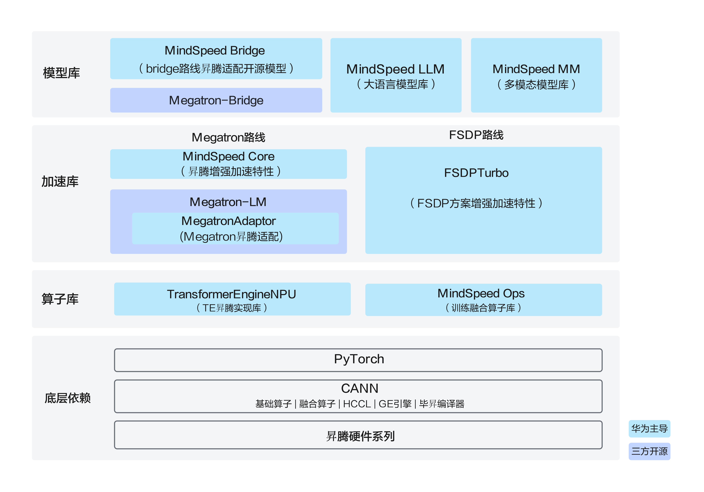

# MindSpeed是什么

MindSpeed是面向华为昇腾NPU的大模型训练软件栈，致力于帮助主流开源训练生态以较低成本迁移到昇腾平台，并获得昇腾亲和的训练性能。MindSpeed覆盖模型适配、分布式训练、性能加速、算子与低精度计算等能力，为大语言模型和多模态模型提供预训练、微调、推理评测及权重转换等流程支持。

MindSpeed按模型库、加速库、算子库组织各组件，并以PyTorch、CANN和昇腾硬件系列为底层依赖。模型库提供模型适配与任务流程，加速库提供训练引擎适配与昇腾增强加速特性，算子库提供低精度计算与融合算子能力，共同支撑上层模型训练。

## 总体架构

**图 1**  MindSpeed整体架构

**表 1**  MindSpeed组件介绍

| 组件 | 定位 | 主要能力 |
| --- | --- | --- |
| MindSpeed LLM | 大语言模型库 | 提供端到端LLM工业级训练方案，覆盖分布式预训练、指令微调、后训练、在线推理及基线评估，原生内置100+主流大模型及Dense、MoE、SSM等模型架构。 |
| MindSpeed MM | 多模态模型库 | 提供多模态理解、文生图、视频生成等端到端训练流程，内置40+组前沿预置模型示例。 |
| MindSpeed Bridge | Bridge路线开源模型适配 | 提供新模型引入的provider/bridge/recipe三件套，支持HuggingFace与Megatron双向权重无损转换，并具备核心特性的插件化解耦能力。 |
| TransformerEngineNPU | Transformer Engine昇腾实现 | 支持E4M3、HiF8等低精度格式及MXFP8等Scaling策略，提供高性能Transformer计算模块，降低低精度训练迁移与性能适配成本。 |
| MegatronAdapter | Megatron-LM内部昇腾适配 | 提供Megatron-LM / Megatron Core在昇腾NPU上运行所需的基础兼容能力，并通过特性管理与补丁机制适配设备、运行时及框架差异，降低Megatron训练栈迁移至昇腾平台的适配成本。 |
| FSDPTurbo | FSDP方案增强加速 | 提供内存复用与混合量化管理，支持与TP、EP、CP等多维并行策略的灵活高效组合。 |
| MindSpeed Core | Megatron路线昇腾增强加速 | 围绕计算、内存、通信、并行四个维度提供亲和优化，聚焦长序列、MoE、通信计算融合、内存优化及低精度训练等昇腾特色加速能力。 |
| MindSpeed Ops | 训练融合算子库 | 集成基于Triton-Ascend、TileLang及AclNN的全场景融合算子与架构亲和内核，通过统一API屏蔽底层硬件差异，实现算子的高效分发与性能释放。 |

## 关键功能特性

- **低成本生态迁移**：支持原生Megatron-LM训练脚本的“一行导入”级NPU亲和适配；通过MindSpeed Bridge的标准命令，实现HuggingFace新模型向Megatron生态的无缝接入，减少模型结构、配置和权重格式的重复开发工作。

- **双分布式引擎路线**：支持Megatron深度优化与模型无关FSDP2两条路线。Megatron路线承接存量资产，提供多维并行与性能调优能力；FSDP2路线采用与模型结构解耦的设计，面向HuggingFace / PyTorch模型提供配置化的FSDP2、TP、EP、CP等并行与内存优化能力，可根据模型结构和训练场景灵活选择训练后端。

- **模型训练流程支持**：MindSpeed LLM覆盖大语言模型预训练、全参数微调、SFT/LoRA、DPO/GRPO/RLHF等后训练，以及模型评测、数据处理和权重转换等流程。

- **广泛模型覆盖**：适配Dense、MoE、SSM及多模态主流架构。MindSpeed LLM原生内置100+主流大语言模型；MindSpeed MM提供40+组涵盖多模态理解、文生图、视频生成与语音的模型示例。

- **多维并行加速**：支持数据并行、张量并行、流水线并行、上下文（长序列）并行、序列并行与专家并行等策略，可按模型结构与集群规模灵活组合，并支持全分片FSDP2大规模训练。

- **昇腾亲和性能优化**：依托内存复用/交换、激活值动态重计算缓解显存瓶颈；通过通算融合、通信-计算多级重叠、MoE专用通信优化、长序列优化及高性能定制算子，提升大规模集群的训练效率与算力资源利用率。

- **低精度训练**：提供覆盖FP8、MXFP8、HiF8、W8A16等格式与训练策略的低精度能力，通过TransformerEngineNPU、MindSpeed Core与FSDPTurbo等组件实现低精度计算、分块量化和低精度通信等优化，在兼顾训练精度的同时降低计算、通信与内存开销，提升大模型训练效率。

- **主流生态兼容**：面向Megatron Core、HuggingFace、PyTorch FSDP2、Transformer Engine、Megatron-Bridge等主流训练生态提供API、模型与权重格式适配能力，在保持上游生态演进兼容性的同时提供昇腾亲和扩展，降低框架迁移、模型适配和版本升级成本。

## 更多介绍

关于MindSpeed的更多介绍，可参见在线课程：[MindSpeed](https://www.hiascend.com/edu/courses?activeTab=MindSpeed)。
